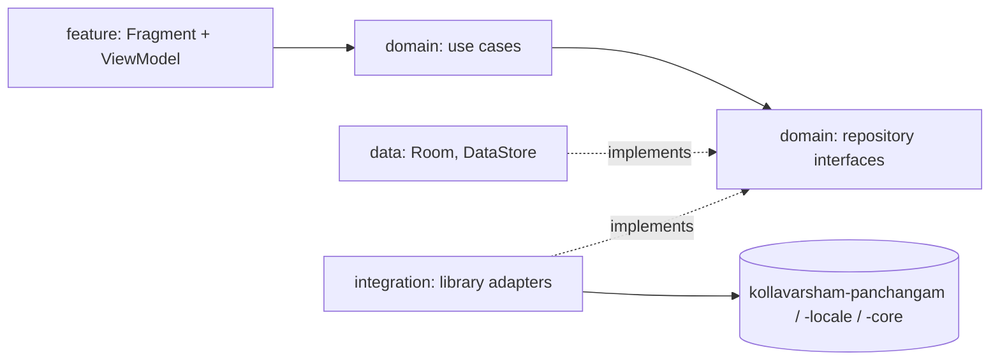

# Architecture

## Principles

- **MVVM + Clean Architecture**, single `:app` module with strict package layering. Feature modules can be split out later without changing the code inside each layer.
- **The domain is pure Kotlin.** It contains no Android types and no library types, so it's testable on the JVM and independent of the UI toolkit.
- **No calendar logic in the app.** Malayalam dates and nakshatras come from the library, behind domain interfaces.
- **The UI only renders.** Fragments collect an immutable `UiState` from a `StateFlow`; ViewModels hold no View references.

## Layers and packages

```
io.github.anjalymsajeev.nakshatracalendar
├── core/          common (AppResult, AppError, dispatchers), database (Room), di (Clock, dispatchers)
├── domain/        model, repository (interfaces), usecase
├── data/          local (Room entities, DAOs), repository (implementations, DataStore)
├── integration/   malayalamcalendar, nakshatra (library adapters), googlecalendar (Sprint 4)
└── feature/       home, person, calendar, settings  (+ nakshatra, eventpreview, sync later)
```

Dependencies point inward: `feature → domain ← data / integration`. Hilt modules bind the implementations.



## Library integration

| Domain interface | Implementation | Library API used |
|---|---|---|
| `MalayalamDateProvider` | `KollavarshamDateProvider` | `KollavarshamCalendar.fromGregorian`, `MalayalamMonth.displayName`, `MalayalamDate.format` |
| `NakshatraEngine` | `PanchangamNakshatraEngine` | `Panchangam.create(PanchangamLocation)`, `sunrise`, `nakshatraSpan`, `nakshatraOccurrences` (0.2.0), `Nakshatra.displayName` |
| `PlaceSearchRepository` | `GeocoderPlaceSearchRepository` | Android `Geocoder` (via `GeocoderClient`), `android.icu.util.TimeZone` (via `TimeZoneResolver`) |

- Library exceptions are mapped to `AppError` at the adapter: `DateOutOfSupportedRangeException` becomes `UnsupportedDate`, and failed calculations become `CalculationFailed`.
- Nakshatra (astronomy) and Malayalam date conversion are separate interfaces backed by separate library modules.
- Sprint 3 uses the library's `Panchangam.nakshatraOccurrences` (0.2.0) for the date-range results.

## State and data flow

`GetTodayOverviewUseCase` combines the settings `Flow`, the family-count `Flow` (Room) and the library calls into an `AppResult<TodayOverview>`. `HomeViewModel` maps it to `HomeUiState` (`Loading`, `Content` or `Error`) with `stateIn(WhileSubscribed)`. Heavy work runs on `@DefaultDispatcher`.

## Persistence

- **Room** (`AppDatabase`, schema v2, exported to `app/schemas`). v1→v2 is an auto-migration (birth place columns) with a `MigrationTestHelper` test. Every version change ships a migration and a migration test.
- **DataStore:** theme and star-day convention.
- **Language:** AppCompat's per-app locale (`setApplicationLocales`), the single source of truth.
- **OAuth tokens are never stored by the app.** Google Identity Services manages them (Sprint 4).

## Compose migration path

Screens can be swapped one at a time: `HomeUiState` and the ViewModels don't depend on Views, so a Composable can collect the same `StateFlow`. Repositories, use cases, the database and the integration layer stay unchanged. No Compose dependency is added until migration starts.
